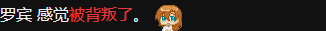

# NPC Avatars Mod — DoL 0.5.11.9 兼容修订

这是基于 **[Eudemonism00](https://github.com/Eudemonism00)** 的 **[NPC Avatars Mod 原项目](https://github.com/Eudemonism00/DOL-NPC-Avatars-Mod)** 制作的第三方兼容修订，不是原作者的官方发布。头像素材与原始模组代码归原作者及相关贡献者；本仓库仅维护下述小范围适配。

**[下载适配包](https://github.com/102326/DoL-NPC-Avatars-Compat/releases/tag/v1.4.1-dol05119.1)** · [原作者使用说明](src/README.md) · [许可与署名](LICENSE.md) · [验证范围](docs/VALIDATION.md)

## 目标版本

| 组件 | 本地验证版本 |
| --- | --- |
| DoL | 0.5.11.9 |
| ModLoader 核心 | 2.101.1 |
| TweeReplacer | 1.7.0 |
| ImageLoaderHook | 2.101.0 |
| BeautySelectorAddon / 转换插件 | 2.9.0 / 1.1.0 |
| ModI18N | 1.0.0a |
| Lyra | 0.5.11.9-1.0.0a-0815-goose-ucb |

修订版本：`1.4.1-dol05119.1`，基于原包 `1.4.1`。保留原依赖声明：`TweeReplacer >=1.0.0`、`ModLoader DoL ImageLoaderHook ^2.3.0`。无需 Simple Frameworks。

## 修改内容

- Robin：去掉当前游戏中没有定义的 `_timer_hurt` 判断，正确显示两种受伤表情。
- Great Hawk：特殊战利品没有对应素材时，回退到已有关系表情，避免缺图。
- 图像说明：未安装 BeautySelector 时不再错误提示“未启用图像”。

保留原名称、四处挂载、所有 518 张图片、CSS、海报与拟态功能，以及原作者说明。原包四个文本替换锚点在目标 HTML 中都能匹配；本修订不声称原包完全无法运行。

## 安装与回退

1. 保留旧包及当前模组/图层配置。
2. 从 Release 下载 `.mod.zip`，在 ModLoader 中替换同名 `NPC Avatars Mod`；不要同时启用原包和适配包。
3. 前置模组先加载。本轮验证顺序是内嵌前置、汉化、Lyra，然后加载本模组。
4. 使用 BeautySelector 时，确认 `converted-NPC Avatars Mod` 图层已启用，完整重载游戏。

回退时导入原作者的 1.4.1 包，或禁用适配包后完整重载。修订没有新增存档字段，不需要存档迁移。仓库中的 `original/` 保留作为适配基准和构建校验输入的原包。

## 验证与限制

真实 ModLoader + 独立桌面 Edge 新游戏环境：19 个头像用例实际 PNG 解码通过，三种 BeautySelector 提示状态通过。隔离页面截图：



**未完成 Android 真机、真实存档、全部 NPC/剧情分支及所有第三方模组组合验收。** 原包未实现的 Sydney 拟态分支仍缺少一张素材；当前原版不会设置该拟态，其他模组若开启它则不保证可用。测试还记录了无模组控制组也会出现的间歇 `skybox` 错误，详见[验证报告](docs/VALIDATION.md)。

## 本地构建

需要 Python 3；资源路径测试另需 Node.js。无需安装第三方构建依赖。

```sh
python build.py
node tests/assets.cjs
```

构建输出到 `dist/`，同时生成 SHA256、构建报告和 `changes.diff`。脚本验证原图片逐字节保留。仓库不含游戏本体、存档或加载器前置。

适配 ZIP SHA256：`511e239bda29367f89d292dbf8261bacc26bc7fb364396abe4e2e99f0e67f8ab`

## 图像说明

您已使用NPC头像增添模组。游戏作者并未提供各位角色的具体形象，头像为模组二次创作，仅供爱好者交流，请勿将其当作官方形象。

请尊重原作者的 DoL 范围使用与保留说明条件，不将本仓库误认为对原作图片授予无条件通用许可。
